# What meshom does

*Draft v0.1.*

An illustrated tour: the meshes meshom builds, how it sets and refines the cell size, how it fits a finer mesh into
a finished one, and how it cleans a mesh. Each section starts with a synthetic example, where everything is easy to
see, and then shows real meshes. The numbers come from the runs' records (`quality.json`, `stages.json`), from the
rows of [`decisions.md`](decisions.md) named next to them, or were measured on the mesh files shown in the figures.

Status marks: **works**: used on real meshes; **experimental**: builds, but the quality is not yet what it should
be; **not yet**: not built.

How to read the mesh windows drawn for this page: the colour of a cell is its largest angle, **light yellow** 90°
(a perfect rectangle), **orange** about 105°, **red** about 120°, **purple** 130°, **black** 150° and more; **grey**
cells are triangles. The axes are km from the window's centre in the tangent plane of the sphere, so cell shapes are
not distorted.

The config reference is [`config.md`](config.md), ready configs are in [`examples/`](examples), and every rule,
threshold and default is listed with its reason in [`decisions.md`](decisions.md). The guide for automated use of
meshom starts at [`AGENTS.md`](../AGENTS.md).

## 1. Meshes meshom builds

A mesh is a set of nodes on the sphere and the cells (elements) between them. meshom builds two kinds.
**Triangle meshes**, as FESOM2 uses. **Mixed meshes**: almost every cell is a quadrilateral close to a square (a
"quad"), and triangles appear only where they are needed, in size transitions and along complex coasts. Mixed meshes
are what FESOM3 needs, and they are what meshom is made for. Everywhere the cell size comes from one function **h**,
the wanted edge length in metres at each point of the sphere (section 2).

### A synthetic example: one size function, two kinds of mesh

The "disc" test case: the whole sphere is water; h = 10 km inside a circle of 500 km radius, then h grows and is
50 km from 900 km on. The two windows show the edge of the disc, with the small cells at the bottom.

| 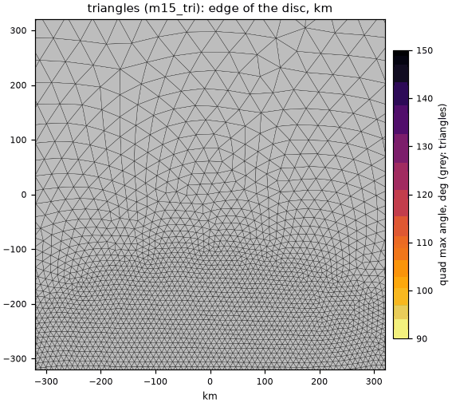 | 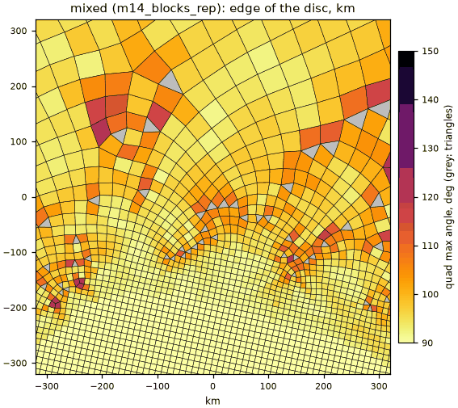 |
|---|---|
| **`m15_tri`, triangles only.** The size grows smoothly from 10 km at the bottom; 247 111 nodes, 15 of 15 gates, 57 s. | **`m14_blocks_rep`, mixed.** A regular lattice inside the disc; in the transition ring quads of different directions meet, with the few triangles. 214 684 nodes, 840 triangles, 21 of 21 gates, 213 s; 0.06 % of the quads above 120°. |

| 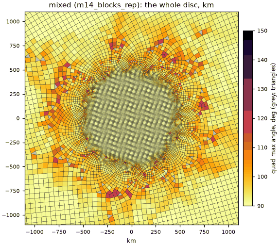 | 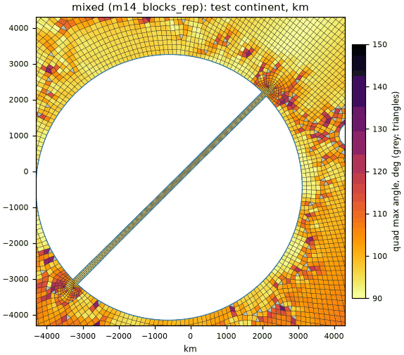 |
|---|---|
| **The whole disc, `m14_blocks_rep`.** One 10 km lattice block inside, coarser blocks outside, a fill between them. | **The test "continent"** (h twice the reference, so four times fewer nodes): a cap of 30° radius with a 150 km channel and an island on the right. Regular lattice blocks lie along the coast and in the open ocean; quads and a few triangles fill the gaps. 50 470 nodes, 435 triangles, 127 s. |

### Methods

- `m14_blocks_rep` **works**: mixed meshes, the default. It places blocks of a regular lattice along the coast and
  in the open ocean and fills the gaps with the frontal method `m02_linf_frontal` (rows of quads grow from the edges
  inward). Then it repairs defect clusters, fits the size within a tolerance and optimises the mesh (section 4).
- `m15_tri` **works**: triangle meshes for FESOM2. It passes every gate on every test case and scale tried, up to
  12.2 M nodes.
- `m02_linf_frontal` **experimental** on its own: fast, but its size strays beyond the tolerance. It is used as the
  fill inside `m14_blocks_rep`.
- `m16_orca` **works**: NEMO's ORCA grids (below).

The choice comes from a comparison of many methods, from isotropic triangles to Instant Meshes and QuadriFlow, on
the same synthetic cases with the same gates (`meshom compete`; the methods are described in [`methods/`](methods)).

### Real meshes: three mixed FESOM3 meshes and a FESOM2 triangle mesh

| 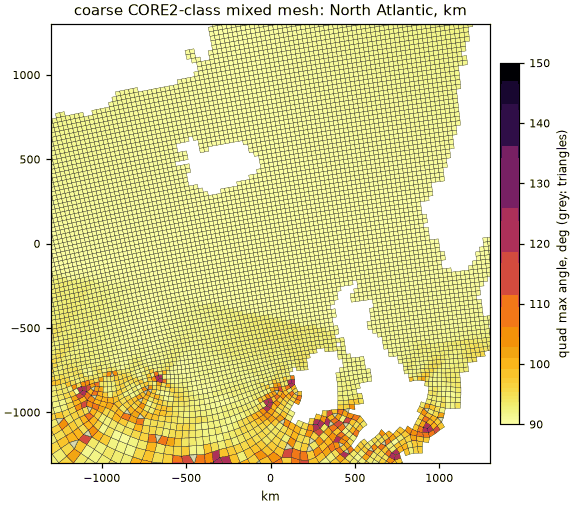 | 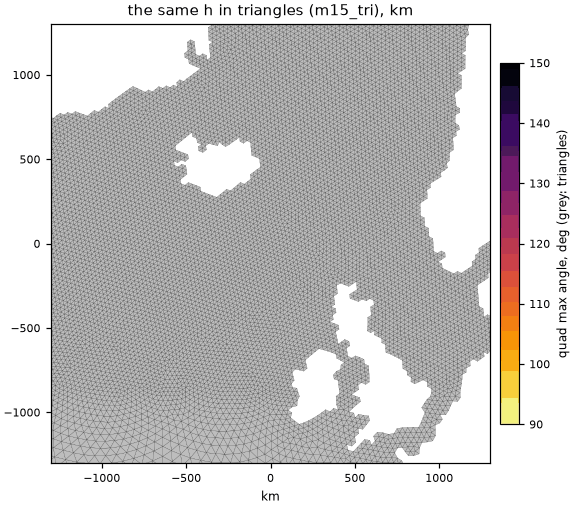 |
|---|---|
| **The coarse CORE2-class mixed mesh**, Iceland and the British Isles. A regular lattice in the open ocean; the defects sit at the coast and on the seams between blocks. | **The same h in triangles** (`m15_tri`). 163 386 nodes, 29 of 29 gates. |

| 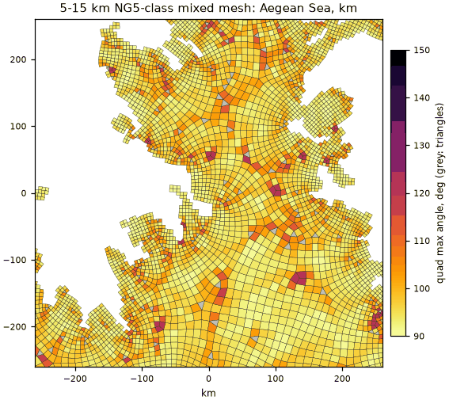 | 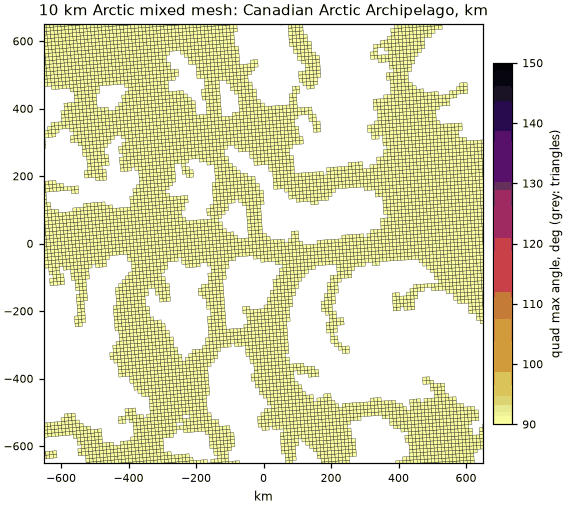 |
|---|---|
| **The 5-15 km NG5-class mixed mesh, Aegean Sea.** 5 km at the coasts and in the straits. Quads go round the islands; the triangles stand alone. | **The 10 km Arctic mesh, Canadian Arctic Archipelago.** 10 km north of 60° N; the straits of the archipelago are open and resolved. |

| Mesh | Config | Purpose | Nodes | Quads / triangles | Gates | Quads > 120° | Build | Model run |
|---|---|---|---|---|---|---|---|---|
| coarse CORE2 class | [`fesom2_core2like_widen.toml`](examples/fesom2_core2like_widen.toml) with `method = "m14_blocks_rep"`, `format = "fesom3"` | 110 km in the open ocean, 25-30 km at the coasts and in the north | 144 439 | 135 800 / 3 720 | 39/39 | 0.62 % | 16 min, 16 CPUs | FESOM3, 10 days at 30 min |
| fine NG5 class | [`fesom3_meshB.toml`](examples/fesom3_meshB.toml) | 5-15 km, all 90 listed straits resolved | 3 870 736 | 3 795 075 / 36 910 | 39/39 | 0.19 % | 6 h 17 min, 32 CPUs | FESOM3, 5 days at 6 min |
| 10 km Arctic | [`fesom3_meshC_arctic.toml`](examples/fesom3_meshC_arctic.toml) | the Arctic at 10 km, the rest coarse | 280 941 | 268 281 / 4 502 | 39/39 | 0.35 % | | |
| triangles, CORE2 class | [`fesom2_core2like_widen.toml`](examples/fesom2_core2like_widen.toml) | the same h as the coarse mixed mesh, for FESOM2 | 163 386 | 0 / 314 044 | 29/29 | | 4 min, 16 CPUs | FESOM2 format |

The gates are a set of quality thresholds (angles, size jumps between neighbours, fidelity to h, triangle clusters,
water connectivity): 39 for mixed meshes, 29 for triangle meshes ([`config.md`, `[gates]`](config.md#gates)). The
fine and the Arctic mesh pass 39 of 39 after the optimisation stage and 38 of 39 before it. The share of quads above
120° was measured on the mesh files.

### ORCA grids **works**

ORCA is the tripolar grid of the ocean model NEMO: its two northern grid poles are hidden on land. meshom has a port
of NEMO's grid generator (G. Madec), so ORCA1, ORCA05, ORCA025 and ORCA12 match NEMO's grids to below 1 m away from
the poles, ORCA2 to a few km. The land-sea mask is NEMO's, cell for cell. ORCA can also be built with FESOM3's rules,
as FESOM3 builds its own ORCA025. Whole grids: ORCA2, 16 236 quads, 3 min; ORCA1, 65 160 quads, half a minute;
ORCA025, 903 398 quads, 3 min on 32 CPUs ([`orca2_whole.toml`](examples/orca2_whole.toml),
[`orca1_whole.toml`](examples/orca1_whole.toml), [`orca025_whole.toml`](examples/orca025_whole.toml); config:
[`config.md`, ORCA grids](config.md#nemos-orca-grids-method--m16_orca)).

| 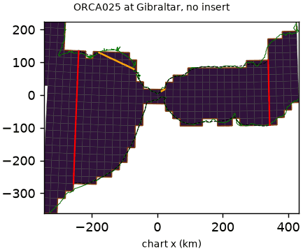 | 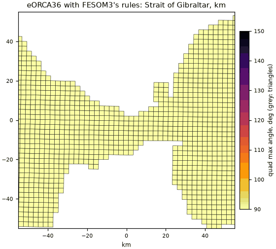 |
|---|---|
| **ORCA025 at Gibraltar** (another colour scale). The strait is 1-2 cells wide. | **eORCA36 at Gibraltar** (1/36°, FESOM3's rules). The strait is open without any edit, cells about 2.5 km, every quad near-rectangular (the largest angle in the window 90.4°). The whole mesh: 73 614 873 nodes, 73 388 056 quads, no triangles; the nodes are NEMO's coordinates, nothing is rebuilt. |

### ORCA joined to a refined region **works**

ORCA is taken between two latitudes or up to a given line, and beyond it meshom builds its own mesh, for example a
fine Arctic. The ORCA nodes do not move (displacement 0 m). The joint runs along an ORCA row and holds single
triangles.

| 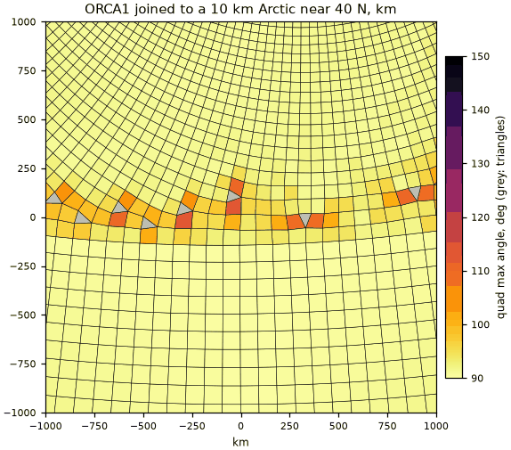 | 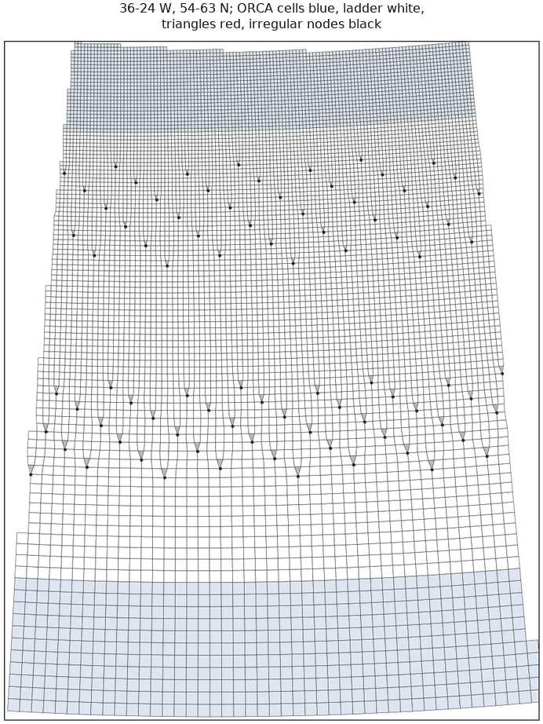 |
|---|---|
| **ORCA1 from 80° S to 40° N and a 10 km Arctic** ([`orca1_40n_arctic10.toml`](examples/orca1_40n_arctic10.toml)), the joint in the Atlantic. ORCA1 cells below, meshom's mesh above, triangles on the joint. 217 150 nodes, 262 triangles, 0.02 % of the quads above 120° (B95). 35 of 39 gates: the size gate fails on ORCA by design, its cells are anisotropic. | **ORCA025 with an Arctic of ORCA12 cells** (about 4.5 km; [`orca025_arctic_v5.toml`](examples/orca025_arctic_v5.toml)), 36-24° W, 54-63° N. ORCA025 below, a ladder strip in the middle (each coarse column split into three), ORCA12 above. 1 804 885 nodes, 1 108 triangles (B117). |

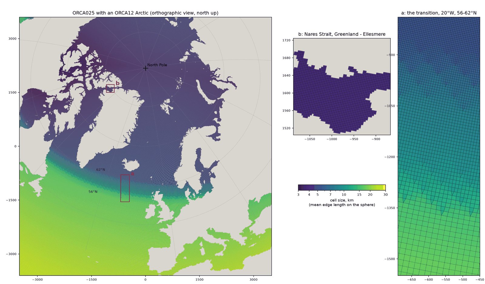

**The same mesh as a whole**, in an orthographic view with north up. The colour is the cell size: about 3-5 km in
the Arctic (ORCA12), 15-25 km in the Atlantic (ORCA025), the transition between 56° and 62° N. a: the ladder strip
south of Iceland, where each coarse column splits into three; b: Nares Strait between Greenland and Ellesmere
Island, ORCA12's cells follow the coast as steps of the grid.

A similar mesh with a meshom block north of 62° N and the joint at 56° N
([`orca025_arctic45_v3.toml`](examples/orca025_arctic45_v3.toml)) passes 39 of 39 gates and FESOM3's preprocessor
`fesom_ini`; it builds in 60 min on 128 CPUs (B107).

### A finer ORCA nested in a coarser one **works**

A box is cut out of ORCA025 along its own grid lines, and ORCA12 is placed in it. ORCA12 is exactly 3 times finer, so
every third ORCA12 node is an ORCA025 node. Between them lies a frame of 24 rings in which the cells shrink smoothly
by the factor 3. The nodes of both ORCA grids do not move
([`orca025_gs_nest.toml`](examples/orca025_gs_nest.toml); B172-B177).

| 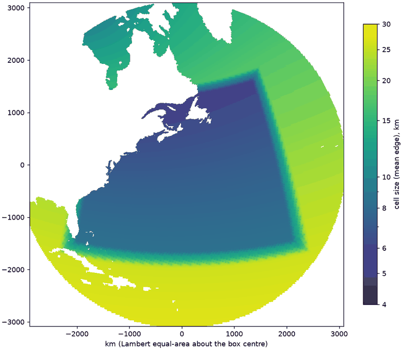 | 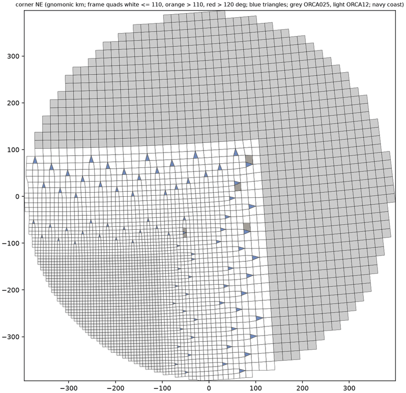 |
|---|---|
| **The Gulf Stream box**, 80-40° W, 25-50° N; the colour is the cell size in km. ORCA12 inside (8.4-5.9 km), ORCA025 outside (26-17 km), the frame round the box. | **A corner of the frame in the open ocean.** Blue triangles are where one cell becomes three; orange cells have angles above 110°. |

- The mesh: 1 077 873 nodes, 814 triangles (all in the frame).
- The largest angle in the frame: 112°; angles above 110°: 0.08 %.
- FESOM3: 10 days, stable; the same box in the ORCA025 mesh with the ORCA12 Arctic, 1 966 892 nodes, also 10 days
  (B177, B178).

### Regional FESOM-C meshes **not yet**

meshom writes FESOM-C's file format (it is even the default format). The regional mode is not built: an area cannot
be cut out by a polygon yet, and the nodes of an open boundary are not marked.

### Formats and quality records **works**

- `fesom3`: mixed meshes for FESOM3; `fesom_ini` can run right after the writing as a check.
- `fesom2`: triangles only. Do not use it with a quad method: the quads would be lost in the writing.
- `fesom-c`: FESOM-C's mixed files.
- Every run folder holds `quality.json` (gates, angles, size jumps, water connectivity) and `stages.json` (time and
  memory of every stage, the host, the commit), and optionally a standard set of figures. Every writing checks that
  the water is one piece.
- Node depths come from GEBCO (or another grid), with rules for the coast and the straits.

## 2. Refinement: the size function h

The **size function h** is the wanted edge length at each point of the sphere. It is built from layers. Each layer
proposes a size, and the smallest wins: the strictest requirement holds. Then the **gradient limiter** works: the
size may not change faster than a given slope g. With g = 0.1 the size changes by at most 10 km per 100 km of
distance. Without it neighbouring cells could differ sharply in size. Config:
[`config.md`, `[size]`](config.md#size-and-sizelayers).

### A synthetic example: layers, minimum and limiter

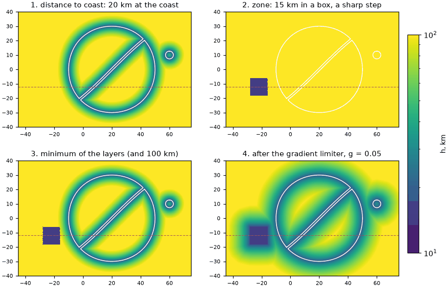

**Layers on the test continent** (meshom's functions; white lines: the coast). 1: 20 km at the coast, growing
away from it. 2: a 15 km box with a sharp step. 3: the smallest of the layers and 100 km. 4: after the limiter with
g = 0.05 the box's step has become a smooth slope.

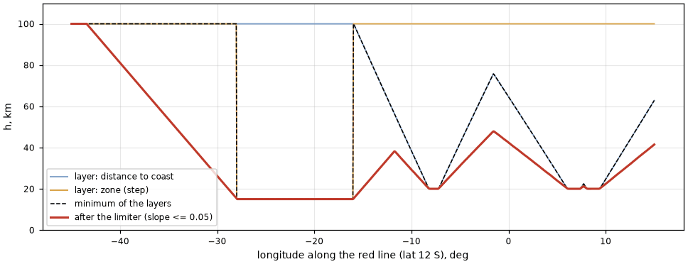

**A section along the red line.** Dashed: the minimum of the layers, with cliffs at the edges of the box. Red:
after the limiter, slopes no steeper than 5 %.

### Layers

- `constant`: the same size everywhere **works**.
- `latitude`: h cos(latitude) with a lower bound **works**.
- `coast_distance`: a size at the coast, a plateau, then growth with distance; can be set apart for continents and
  islands **works**.
- `zone`: a polygon with its own size inside and a transition outward. Modes: "minimum", "set" (coarser or finer
  than the layers before it), "smooth" and "blend" toward an ORCA edge **works**.
- `orca`: the size of the ORCA cells, so that meshom's mesh continues ORCA without a jump **works**.
- Strait zones (below) come after the overall `h_min_m` / `h_max_m` clip, so a 10 km strait survives an h_min of
  20 km **works**.
- A layer by depth (finer on the shelf and over the slope) **not yet**: there is no such layer.

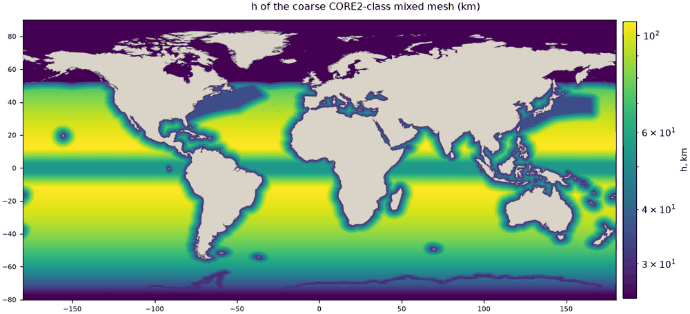

**The size function of the coarse CORE2-class mesh.** 110 km in the open ocean, by cos(latitude) toward the poles
down to 25 km, 30 km at the coasts. Zones: 25 km north of 52° N, 35 km in the Gulf Stream and the Kuroshio, 55 km in
three equatorial bands; g = 0.1.

### Size tolerance **works**

An edge may differ from h by up to ±22 % (tolerance t = 0.20, the default for mixed meshes, G38). Within this band
the last stage makes the size between neighbours as smooth as possible: smoothness matters more than the exact h.
On the coarse mixed mesh:

| Tolerance | Gates | Size jump between neighbours (p99) |
|---|---|---|
| none | 31/39 | 1.206 |
| 0.10 | 39/39 | 1.121 |
| **0.20 (default)** | 39/39 | 1.110 |
| 0.30 | 38/39 | (a triangle cluster) |

### Straits **works**

The built-in list holds 90 straits: the 88 strait paths after D. Sein (AWI), fesom2_mesh_gen, plus the Great Belt
and the western exit of the Sea of Marmara (C27). Gibraltar is always open, on every mesh. Each mesh has its own
strait **profile**. `widen`: the strait is meshed at the background size but at least 2 cells wide, and its corridor
is cut into the land; no small cells, a long time step (the coarse mixed mesh: 90 of 90 straits at least 2 cells
wide). `resolve`: a zone of its own size along the strait (the NG5-class mesh: every strait at 5 km). Regions choose
the profile by place, for example resolve the Arctic and leave the Baltic alone
([`config.md`, strait profiles](config.md#strait-profiles-coast-strait_profile-strait_regions)).

| 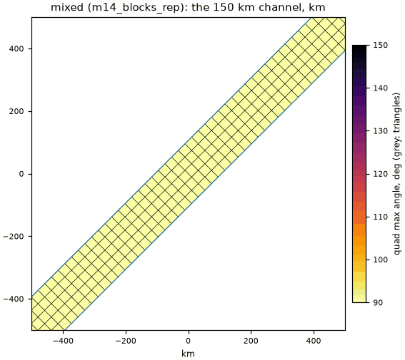 | 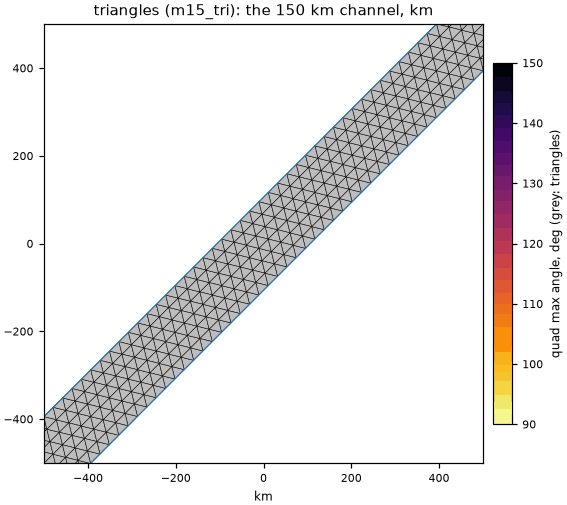 |
|---|---|
| **Synthetic: the 150 km channel** of the test continent, h = 30 km. Quads in straight rows, 5 cells across. | **The same channel, `m15_tri`.** 56 442 nodes, 35 of 35 gates, 20 s. |

**Narrow passages** **works**. After the land cut meshom searches the finished mesh for every passage narrower than
2 cells, listed or not, and widens it. The coarse mixed mesh had 49 of them, 0 after the widening, and passes all 39
gates ([`config.md`, narrow passages](config.md#narrow-passages-coast-passage_min_cells); C51).

| 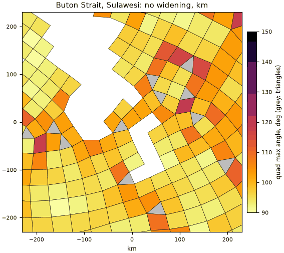 | 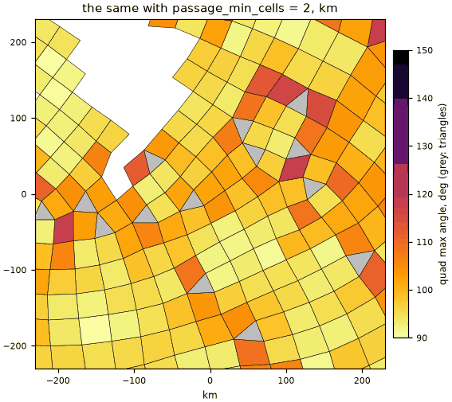 |
|---|---|
| **Before: the coarse mixed mesh at Sulawesi** (Buton Strait). A passage one cell wide. | **After: the same mesh with `passage_min_cells = 2`** (the default). The passage is at least 2 cells wide. |

**Automatic straits on the medial axis** **experimental**. Passages are found on the medial axis of the coast (the
line equally far from two shores) and given a size. With CORE2-class sizes only passages wider than about 100 km
open. Off by default ([`config.md`, automatic straits](config.md#automatic-straits-coast-auto_straits)).

### Small islands **works**

Islands smaller than `min_area_km2` are dropped (3000 km² in the global examples, 1000 km² in the NG5-class mesh).
An island is a coast polygon of less than 100 000 km². The refinement at the coast can be set apart for continents
and islands (S33).

| 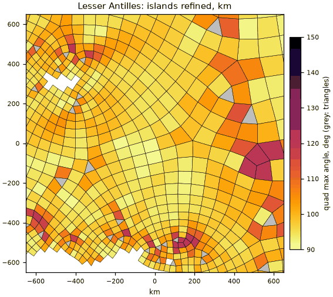 | 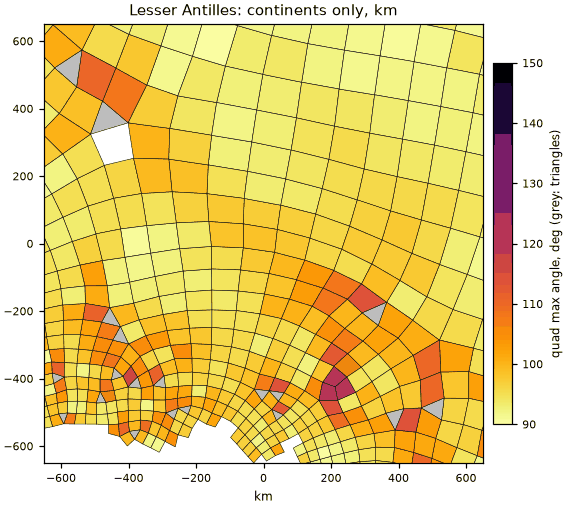 |
|---|---|
| **The coarse mixed mesh, Lesser Antilles.** The islands get 30 km, as the continents do, each in a ring of small cells. | **Refinement at the continents only** (`coasts = "continents"`). The islands sit in large cells, the lattice is more regular; 137 639 nodes instead of 144 439, 39 of 39 gates. |

### Connected water **works**

A global mesh keeps only the water connected to the world ocean: no lakes and no cut-off basins (C48). The Black Sea
stays only when its straits are open. Every writing checks the water again; when it has fallen apart, meshom prints
`WATER NOT CONNECTED` with the size and place of each piece. Joining a cut-off basin by itself is **not yet** built.

## 3. Inserts: a finer mesh inside a finished one

An **insert** is a patch of a structured quad mesh fitted into a finished mesh: in a strait, along a coast or along a
current. Its ends sit on nodes of the finished mesh, and its banks follow the real coastline, not a staircase. The
**join** is where the insert meets the host mesh. The **collar** is a band of the host mesh round the join that is
cleaned together with the edge of the insert. An insert is made by its own command, after the build and only on
request: `meshom run` never makes one ([`config.md`, `[[inserts]]`](config.md#inserts-python--m-meshominsert)).

### A synthetic example

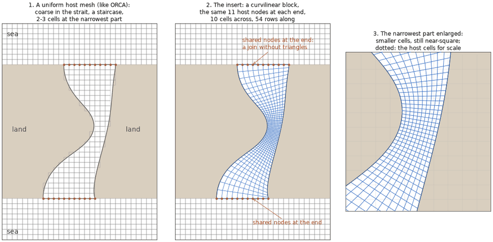

**The idea.** Left: a strait in a coarse mesh, 2-3 staircase cells. Middle: a smooth mesh fitted in its place on the
same end nodes. Right: the narrowest part enlarged.

### Straits **works**

The maps of this block use another colour scale: dark blue 90°, green about 110°, yellow about 115°, red 135° and
more; magenta cells are triangles; the red line is the join, the green line the real coast.

| 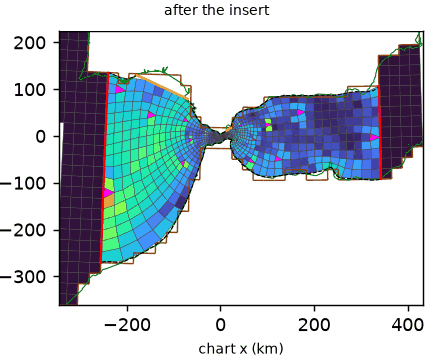 | 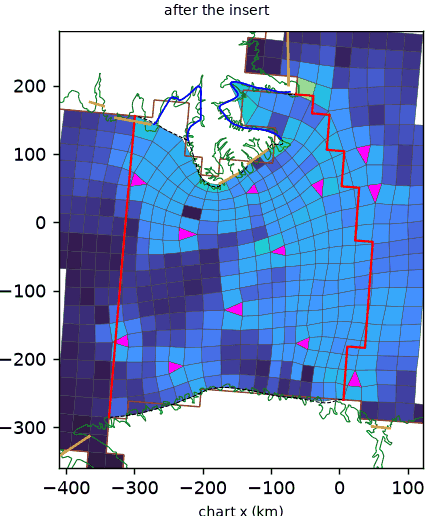 | 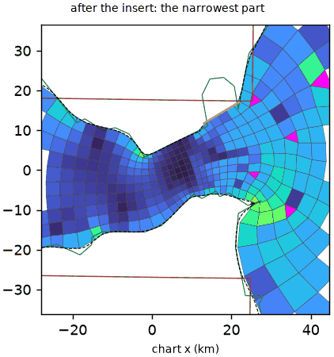 |
|---|---|---|
| **Gibraltar in ORCA025, 10 cells across** (1-2 before the insert, section 1). The ORCA nodes do not move, the joins follow ORCA's grid lines, the worst angle is 120°. | **Denmark Strait in the coarse mixed mesh, 20 cells.** Breiðafjörður (blue outline) keeps a block of its own: a 70 km mouth, 3.4 cells. | **A small bay closed.** The mouth of the Bay of Algeciras is closed by the orange line; the coast along the strait is smooth. |

**Bays.** By default (`bays = "auto"`) a bay gets its own block when its mouth holds at least 3 insert cells and the
bay reaches inland at least as far as its mouth is wide. Other bays and lagoons are closed by a line across the mouth.
`true` takes every bay, `false` none (B190).

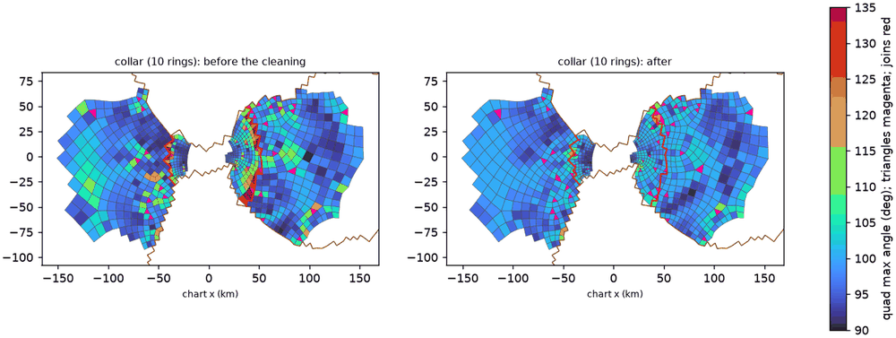

**The collar in the NG5-class mesh: Gibraltar, 14 cells.** Left before the cleaning, right after. 10 rings of the
host mesh and 4 rows of the insert are cleaned together; beyond the 10 rings no node moves. The red cells at the join
are almost all gone (B192).

| Strait, host mesh | Cells across | Worst angle | Angles > 120° | Size jump (p99), target 1.15 |
|---|---|---|---|---|
| Gibraltar, NG5 class | 14 | 120° | 0.5 % | 1.30 |
| Bonifacio, NG5 class | 8 | 108° | 0 % | 1.25 |
| Dover, NG5 class | 10 | 120° | 0.2 % | 1.27 |
| Denmark Strait, coarse mixed | 20 | 110° | 0 % | 1.18 |
| Denmark Strait, triangle mesh | 20 | 108° | 0 % | 1.15 |
| Gibraltar, ORCA025 (ORCA kept) | 10 | 120° | | |
| Hormuz, ORCA025 | 10 | 118° | 0 | |

The numbers are the insert's own record (`insert_<name>.json`). On ORCA there is no collar by default
(`collar_rings = 0`): the ORCA nodes and cells stay as FESOM3 has them, and the joins follow ORCA's lines (B193). On
meshom's meshes and triangle meshes the collar is 10 rings.

### Coastal strips **experimental**

A strip is an insert along a coast, of a given width. Its rows are lines of equal "temperature": the coast is held
at 0, the join with the host mesh at 1, and the heat equation is solved between them (a harmonic map). Such lines
cannot cross, so the rows do not fold at capes and river mouths (B195-B197).

| 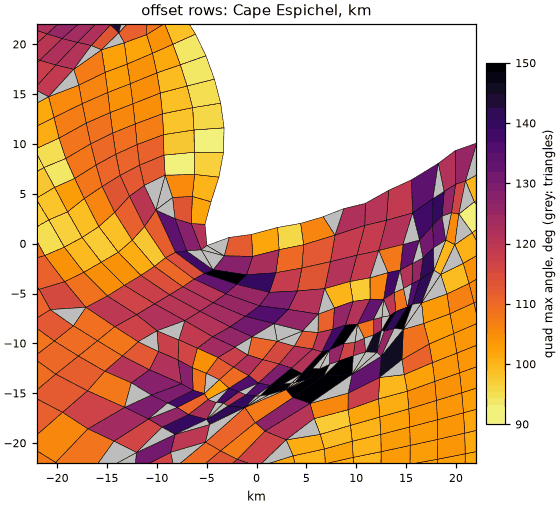 | 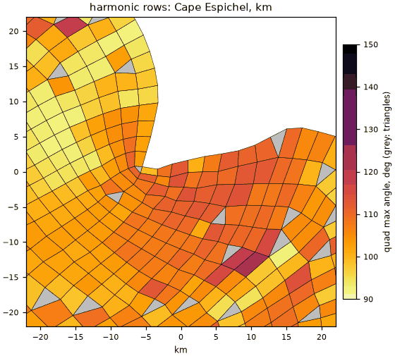 |
|---|---|
| **Offset rows: Cape Espichel** (rows offset from the coast, `rows = "offset"`). The rows fold, cells up to 180°. | **Harmonic rows: the same cape** (the default). The rows go smoothly round the cape; the worst cells are about 120°. |

| 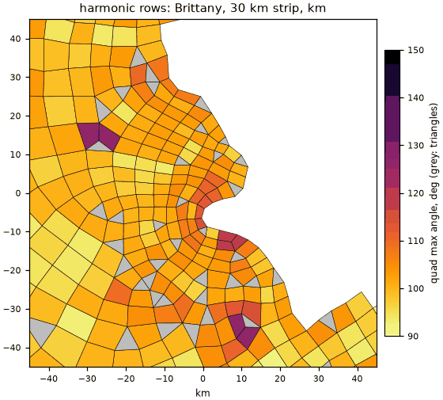 | 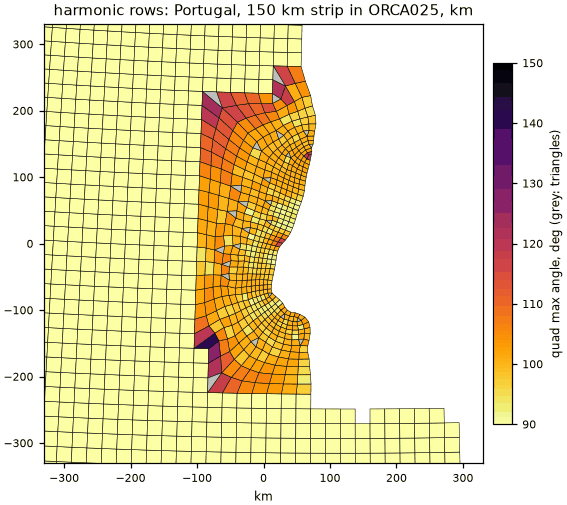 |
|---|---|
| **Brittany, a 30 km strip in the NG5-class mesh.** The rows follow the coast; single cells of about 127° remain. | **Portugal, a 150 km strip in ORCA025**, the ORCA grid kept. Clean inside the strip; bad cells only in the convex corners of the stepped join. |

| Case | Largest angle | Above 120° | Size jump (p99) | Coast shift, mean / largest |
|---|---|---|---|---|
| Portugal, NG5 class, 50 km | 127.7° | 0.4 % | 1.34 | 0.22 / 1.9 km |
| Brittany, NG5 class, 30 km | 126.8° | 1.3 % | 1.22 | 1.0 / 5.3 km |
| Portugal, ORCA025, 150 km | 140.8° | 1.5 % | 1.27 | 1.3 / 4.6 km |

Measured on the strip and its collar; the target is about 125° and less than 1 % above 120°. The offset rows on
the same coasts: Portugal 180°, Brittany 10 inverted cells, ORCA025 174° (B199). Examples:
[`inserts_gulf_stream.toml`](examples/inserts_gulf_stream.toml).

### Corridors along a current **experimental**

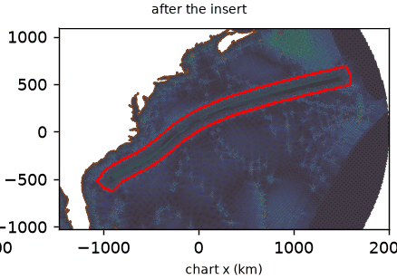

**The Gulf Stream corridor in the NG5-class mesh.** The worst angle is 132°, 27 quads above 120°. The corridor is
still built with offset rows, not harmonic ones.

### How to make an insert

It works in any strait, at any coast, in any finished meshom mesh (and in ORCA grids built by meshom). Nothing of it
happens by itself: an insert is built only on explicit request.

1. A finished run folder is needed (`meshom run CONFIG`); it holds `config.resolved.toml`.
2. Pick the kind. A strait: a name of the built-in list (`strait = "Gibraltar"`) or `path`, points [lon, lat] from
   one basin to the other. A coastal strip: `kind = "strip"`, `path` along the coast and `width_km`. A corridor:
   `kind = "corridor"`, the axis in open water and the full width.
3. Set the detail: `cells` across the narrowest part (default 10) or `h_fine_m`. The insert never makes cells smaller
   than the smallest cell of the host mesh (`h_min_m`).
4. Run one insert inline or all of a file, on a compute node.
5. Look at the result: `insert_<name>.json` (the status), `.map.png`, `.score.json`; the model files are in
   `fesom-insert_<name>/`.
6. When an insert is refused, the `.json` and the log say which rule failed and which value would pass. Most often it
   is the size floor `h_min_m` (by default the smallest cell of the host mesh), the number of cells or the width. A
   ready example of each kind: [`inserts.toml`](examples/inserts.toml).

```
python -m meshom.insert --run RUN_DIR --insert 'name=gib; strait=Gibraltar; cells=10'
python -m meshom.insert --run RUN_DIR --config docs/examples/inserts.toml [--out DIR]
```

```toml
[[inserts]]
name = "denmark"
path = [[-31.0, 64.5], [-22.0, 67.5]]   # from basin to basin, well inside both
cells = 12                              # or h_fine_m = 5000.0
# bays = "auto"   collar_rings = 10 (0 on ORCA)   kind = "strait" (default)
```

## 4. Clean-up and repair

After a method has filled the water, the mesh goes through several clean-up stages. Each changes only what it needs
to and keeps the size within the tolerance.

### Land cut and FESOM's rules **works**

For a global mesh the method first covers the whole sphere. Then every cell whose centre lies on land is removed, and
the mask is cleaned by FESOM2's rules (after D. Sein (AWI), fesom2_mesh_gen; C9-C11): no spurs, no pinched nodes,
only the largest basin kept. The clean-up repeats until the number of wet cells stops changing.

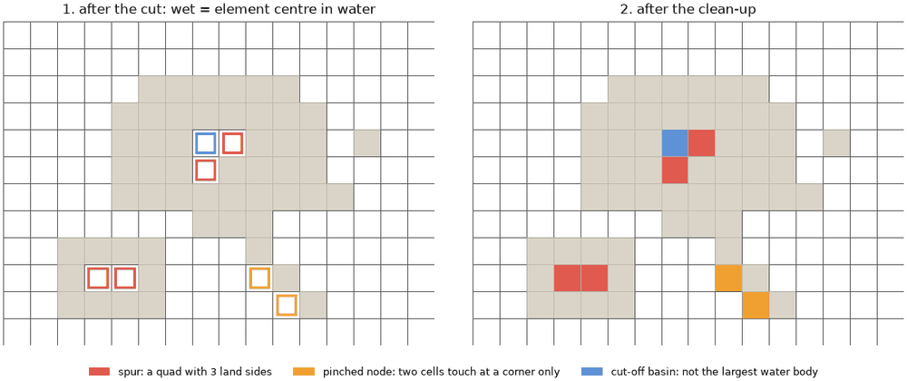

**The rules on a square grid.** A spur is a quad with three sides on land. A pinched node: two cells touch only at a
corner, and the larger group stays. A cut-off basin: water not connected to the main water.

### Repair, size fit and optimisation **works**

- **Repair** (`meshom.repair`): defect clusters are rebuilt.
- **Size fit**: nodes move so that the size jumps between neighbours are as small as possible while every edge stays
  within the tolerance.
- **Optimisation** (the last stage, on by default for mixed meshes): edges are flipped, pairs of triangles merged into
  a quad, triangle clusters broken up, and pairs of nodes with the "wrong" number of neighbours (3 and 5 instead of 4)
  cancel each other.
- Optionally a general smoothing of the angles (`[run] smooth = true`).

| 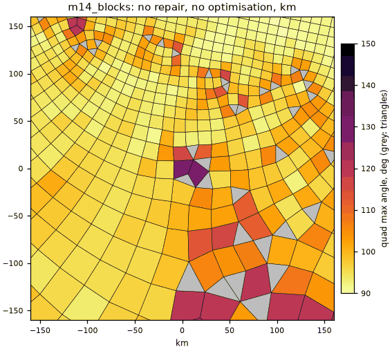 | 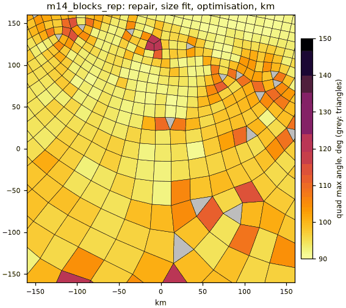 |
|---|---|
| **Before: `m14_blocks` without repair and optimisation**, the transition ring of the disc. 1 798 triangles, 420 quads above 120°, the largest angle 131°; 20 of 21 gates (a cluster of 3 triangles). | **After: `m14_blocks_rep`**: the same blocks, then repair, size fit and optimisation. 840 triangles, 134 quads above 120°, the largest angle 120°; 21 of 21 gates. |

### Post-processing a finished mesh **experimental**

A separate tool for meshes meshom has built: `python -m meshom.meshfix.pipeline --run RUN --stages d,b,e,a`. It may
move any node, add and remove nodes, change connections and carry defects to the coast. Stages: **d** rebuilds
"cavities" round bad cells; **b** moves defects (triangles, nodes with 3 or 5 neighbours) and lets them cancel each
other; **e** carries defects to the coast; **a** smooths the shapes. Triangle meshes have stage **t** (edge flips and
smoothing), then **a**. In every run the mesh stays valid and the coast moves by at most 0.25 h (B149).

| 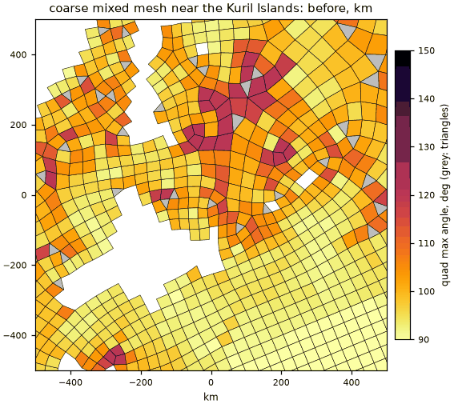 | 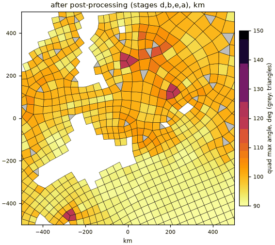 |
|---|---|
| **Before: the coarse mixed mesh near Hokkaido and the Kuril Islands** (the window with the most quads above 120°). | **After stages d,b,e,a.** Far fewer red and purple cells. |

| Mesh | Quads > 120°: before → after |
|---|---|
| coarse CORE2-class mixed | 841 → 283 |
| global 100 km | 433 → 80 |
| CORE2-class mixed, defects at the coasts | 3237 → 951 |
| ORCA1 + 10 km Arctic | 39 → 6 |
| ORCA025 + ORCA12 Arctic (`orca025_arctic_v4.toml`) | 856 → 53 |

Order d,b,e,a (B149, B153). Stage b runs on one thread and dominates the time: 585 s on the coast-heavy CORE2-class
mesh. On meshes where angles above 120° touch the coastal size gates, those gates sometimes start to fail (p99 up to
0.26 at a tolerance of 0.20).

| 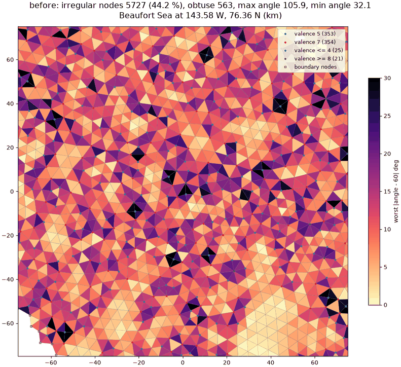 | 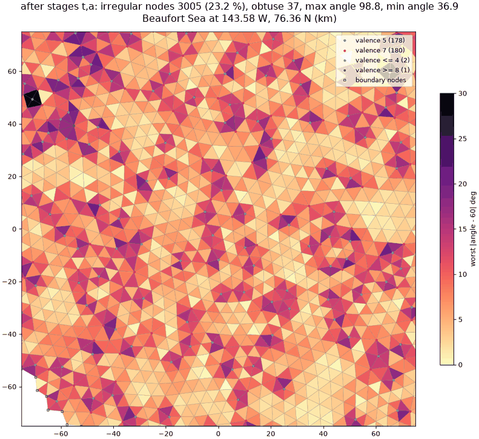 |
|---|---|
| **Triangles: an old FESOM2 Arctic mesh, Beaufort Sea** (only as a hard test case). Dark triangles are strongly distorted (an angle 30° or more away from 60°); 44 % of the nodes do not have 6 neighbours. | **After stages t,a**: 23 % "irregular" nodes, 37 obtuse triangles instead of 563. The number of nodes does not change. |

On meshom's own triangle meshes stage t changes almost nothing: they are already at its optimum. There stage a does
the work.

## 5. Tools

- **Web UI** `meshom ui` **works**: edit the config, see h on the globe, look at a finished mesh (worst cells,
  irregular nodes, windows), edit node depths and nodes, write model files. The server never builds a mesh: its "Run"
  writes an sbatch script. On Levante the server runs on a compute node and is viewed through an ssh tunnel
  ([`README.md`](../README.md)).
- `meshom run CONFIG` builds; `meshom runs` gives one line per run: status, method, nodes, quads, triangles, gates,
  time.
- `meshom write RUN_DIR --format fesom3` writes a saved or hand-edited mesh as model files again. `meshom quality
  FESOM_DIR` runs the gates on any FESOM folder.
- `meshom compete`: the comparison of methods on the test cases with one scoring.
- **The guide for automated use** ([`AGENTS.md`](../AGENTS.md)): how to go from a request such as "build a FESOM3
  mesh of ..." to a method, layers and straits, and how to check the result.
- **The decisions register** ([`decisions.md`](decisions.md), more than 500 rows): every hard rule, threshold and
  default, with its reason and when to revisit it.

## 6. Limits and weak spots

- Regional FESOM-C meshes with open boundaries **not yet**.
- A size layer by depth **not yet**.
- Joining a cut-off basin automatically **not yet**: meshom only reports it.
- The size fit on a GPU for 10⁶-10⁷ nodes **not yet**: CPU only (Numba) for now.
- The seams between blocks hold the defects; blocks cover only about 30 % of a real ocean (29 % in the coarse mixed
  mesh, B8).
- Conforming coasts (`treatment = "loops"`, needed for FESOM-C) are weaker than the land cut: 36-39 of 39 gates, and
  the coast filter costs time and memory.
- The size limiter also works across land: the refinement of a strait leaks through thin land into the next sea. Its
  grid is capped at 12 M nodes (spacing from 7.1 km, S10), so sizes below about 14 km are smoothed on a coarser grid.
- Inserts: a stepped join in ORCA is still bad (up to 165-169° without a collar, B193), the ends of coastal strips
  are about 128°, the corridor still uses offset rows, and the size-jump target of 1.15 at the edge of the insert's
  core is reached only on the triangle mesh.
- The largest meshes on a real coast: 3.87 M nodes (the mixed NG5-class mesh), 1.02 M (triangles); ORCA with
  FESOM3's rules up to eORCA36, 73.6 M nodes, nothing rebuilt.
- The gate thresholds are first settings, not calibrated against good FESOM-C meshes (G0).

| 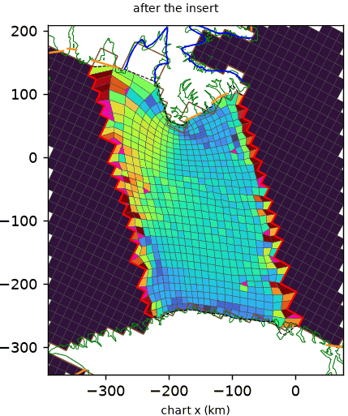 | 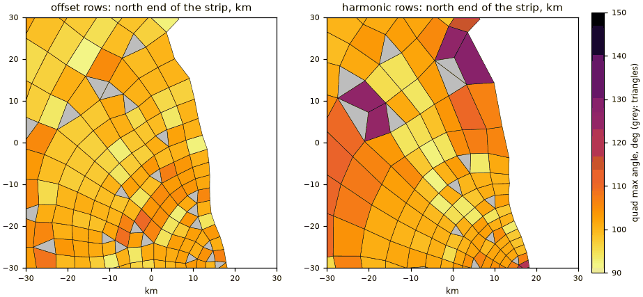 |
|---|---|
| **Denmark Strait in ORCA025, 30 cells, ORCA kept.** Stepped joins along Greenland and Iceland, angles up to 167° (the colour scale of section 3). A collar of 10 rings lowers them, but then the ORCA cells round the strait are no longer FESOM3's. | **The north end of the Portugal strip**, offset rows left, harmonic rows right. Where the strip ends, the cells are about 125-130°: this end still has to be reworked. |
